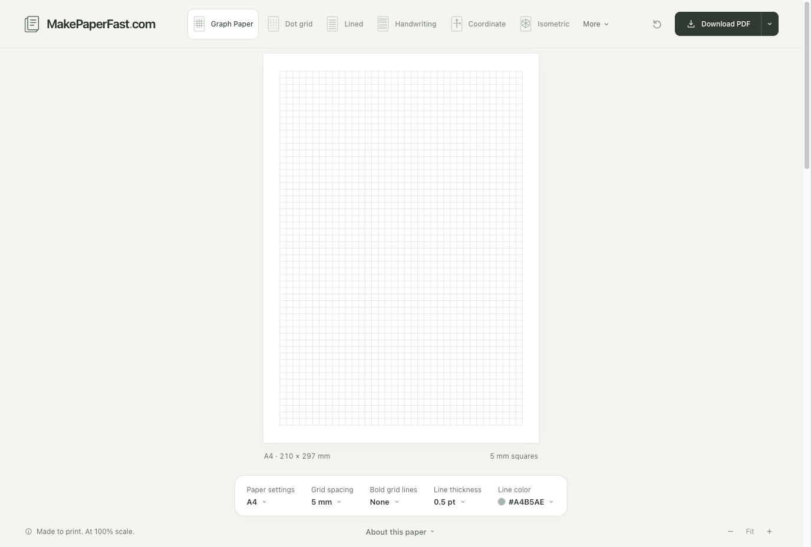

# MakePaperFast

English · [简体中文](README.zh-CN.md)

Make your own printable graph paper, writing sheets, or music staff paper. Start with a sheet on screen, adjust the settings, and see the result as you work. Download a PDF, export a single sheet as SVG, or print directly from your browser.

**Try it at [makepaperfast.com](https://makepaperfast.com/).**

[](https://makepaperfast.com/)

## Local development

Cloudflare Workers renders the React pages on the server. The browser handles editing and creates the PDF and SVG files locally. Tailwind CSS is compiled at build time.

```bash
nvm use 22.0.0
npm ci
npm run dev
```

Open [localhost:8787](http://localhost:8787/). Wrangler builds the browser assets, starts the local Worker, and watches `src/` for changes.

## Paper types and settings

| Paper | Route | What you can adjust |
| --- | --- | --- |
| Graph | `/` | Square size and bold grid line intervals |
| Dot grid | `/dot-grid-paper` | Square or triangular layout, dot spacing, and dot diameter |
| Lined | `/lined-paper` | Ruling, line spacing, heading space, and margin lines |
| Handwriting | `/handwriting-paper` | Two-, three-, or four-line guides, letter height, row gaps, and practice text |
| Coordinate | `/coordinate-paper` | X and Y ranges, quadrants, and axis labels |
| Hexagonal graph | `/hexagonal-graph-paper` | Side length or flat-to-flat distance, hexagon orientation, and map coordinates |
| Isometric | `/isometric-paper` | Triangle size, orientation, and line or dot grids |
| Calligraphy guides | `/calligraphy-guide-paper` | X-height, ascender and descender proportions, and slant guides |
| Cornell notes | `/cornell-notes` | Notes area ruling, cue column width, and summary space |
| Music staff | `/music-staff-paper` | Instrument and choir templates, clefs, staff spacing, systems per page, bar lines, and key and time signatures |

The header links directly to each generator. On narrow screens, additional paper types appear under **More**. The toolbar below the sheet opens page settings and controls for the selected paper.

Choose A2–A5, US Letter, Legal, Tabloid, a 24 × 36 inch poster, or a custom size in millimeters or inches. Set the page orientation, margins, background, and line colors. Zoom in to inspect the lines or fit the sheet to the preview.

Download a one- or multi-page vector PDF or a single-page SVG. To preserve the spacing on paper, select the matching paper size and print at **Actual Size** or **100%**.

## Sharing and search

The editor remembers each paper’s settings in local storage. Copy the address to share a configuration. For example, [this A5 dot grid](https://makepaperfast.com/dot-grid-paper?spacing=8&size=a5) opens with 8 mm spacing.

Each paper has its own URL. Its initial HTML includes the title, description, canonical URL, paper settings, and SVG preview. Shared configurations point to the paper’s base URL as their canonical URL. The old `/graph-paper` and `/?paper=…` addresses redirect permanently to the corresponding generator and preserve its settings. The site serves a [sitemap](https://makepaperfast.com/sitemap.xml) and [robots.txt](https://makepaperfast.com/robots.txt).

## Build and deploy

To build the assets and check the Worker with a Wrangler dry run:

```bash
nvm use 22.0.0
npm run build
```

To deploy to your authenticated Cloudflare account:

```bash
nvm use 22.0.0
npm run deploy
```

`wrangler.jsonc` defines the Worker name, custom domain, and static asset directory. Wrangler deploys the server entry point along with the browser assets in `dist/`.

## Source files

| File | Purpose |
| --- | --- |
| `src/worker.jsx` | HTTP routing, page metadata, and server rendering |
| `src/client.jsx` | React hydration |
| `src/editor.jsx`, `src/header.jsx`, `src/dialogs.jsx`, `src/fields.jsx` | Paper preview, navigation, settings, downloads, and printing |
| `src/paper-state.js` | Paper URLs, input validation, shared settings, and local preferences |
| `src/paper-catalog.js` | Paper types, options, and defaults |
| `src/paper-engine.js` | Paper geometry in millimeters, SVG previews, and vector PDF output |
| `src/styles.css` | Tailwind entry point, responsive layout, and print styles |
