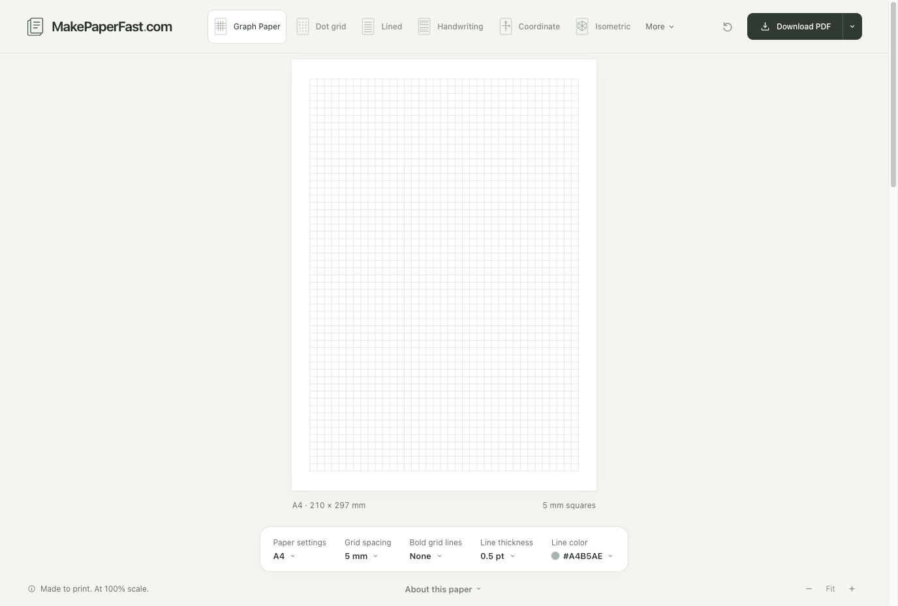

# MakePaperFast

[English](README.md) · 简体中文

MakePaperFast 是一个可打印纸张生成器。Cloudflare Workers 使用 React 在服务器端渲染页面，浏览器接管交互并在本地生成 PDF 和 SVG。Tailwind CSS 在构建时编译。

官网：[makepaperfast.com](https://makepaperfast.com/)

[](https://makepaperfast.com/)

## 本地开发

在项目目录执行以下命令。

```bash
nvm use 22.0.0
npm ci
npm run dev
```

打开 [本地预览](http://localhost:8787/)。Wrangler 会构建浏览器资源、启动本地 Workers 运行时，并监听 `src/` 的变化。

## 页面与 SEO

首页就是方格纸工具，旧地址 `/graph-paper` 会通过 301 跳转到首页并保留纸张设置。各类纸张都可以直接访问，每个页面的初始 HTML 包含标题、描述、规范网址、纸张选项和 SVG 预览。

| 类型 | 路径 |
| --- | --- |
| Graph | `/` |
| Dot grid | `/dot-grid-paper` |
| Lined | `/lined-paper` |
| Handwriting | `/handwriting-paper` |
| Coordinate | `/coordinate-paper` |
| Hexagonal graph | `/hexagonal-graph-paper` |
| Isometric | `/isometric-paper` |
| Calligraphy guides | `/calligraphy-guide-paper` |
| Cornell notes | `/cornell-notes` |
| Music staff | `/music-staff-paper` |

分享链接携带纸张设置。例如，`/dot-grid-paper?spacing=8&size=a5` 会直接渲染 A5、8 mm 点距的预览，canonical 指向 `/dot-grid-paper`。原有的 `/?paper=dot&spacing=8&size=a5` 会通过 301 跳转到新地址。站点地图位于 `/sitemap.xml`，抓取规则位于 `/robots.txt`。

## 当前功能

### 导航

页头按可用宽度显示各类纸张。窄屏隐藏品牌，纸张导航从左侧开始排列，优先显示排在前面的纸张，其余纸张收在 More 菜单中。两种布局都支持通过普通链接访问各纸张页面。

### 纸张类型与独立设置

| 类型 | 主要设置 |
| --- | --- |
| Graph | 方格间距、粗线辅助网格 |
| Dot grid | 点间距、点直径 |
| Hexagonal graph | 边长或对边距离、平顶或尖顶、可选地图坐标 |
| Isometric | 三角形边长、线网格或点网格 |
| Coordinate | 坐标范围、四象限或第一象限、坐标数字 |
| Lined | 行距、左侧边线 |
| Handwriting | 两线、三线或四线练习纸，字高、行间空白和示范文字 |
| Calligraphy guides | 字身高度、升部与降部比例、笔画倾斜角度 |
| Cornell notes | 笔记区样式、提示栏宽度、总结区高度 |
| Music staff | 乐器与合唱模板、逐声部谱号和线数、谱表高度与间距、括号和组首线、每页系统数及调拍号 |

工具条的 Paper settings 可调整纸张尺寸、横竖方向、页边距与背景色。纸张专属参数、线宽和墨色直接从工具条打开，部分参数只在适用的模式下出现。

### 通用功能

- ISO 组提供 A2 至 A5，US 组提供 Letter、Legal、Tabloid 和 Poster（24 × 36 英寸）。Custom 支持按毫米或英寸输入宽高，每边 50 至 1000 mm。
- 纵向与横向。
- 预设墨色与自定义颜色。
- 预览缩放与自动适应。
- 下载单页或多页矢量 PDF。
- 下载单页 SVG。
- 浏览器直接打印。
- 复制包含当前设置的 URL。
- 使用 localStorage 记住每种纸张的设置。

PDF 和 SVG 在浏览器中生成。打印时应选择与文件一致的纸张尺寸，并设置 100% / Actual Size，避免打印机的自动缩放改变格距。

## 构建与部署

在项目目录执行部署预检。

```bash
nvm use 22.0.0
npm run build
```

此命令编译 Tailwind 样式、浏览器脚本和 Worker，并执行 Wrangler dry-run。正式发布到已登录的 Cloudflare 账户时执行以下命令。

```bash
nvm use 22.0.0
npm run deploy
```

Worker 名称和静态资源目录在 `wrangler.jsonc` 中配置。Wrangler 同时发布服务端入口和 `dist/` 中的浏览器资源。

## 源码入口

| 文件 | 内容 |
| --- | --- |
| `src/worker.jsx` | HTTP 路由、SEO 元数据、服务端渲染 |
| `src/client.jsx` | React hydration |
| `src/editor.jsx`、`src/header.jsx`、`src/dialogs.jsx`、`src/fields.jsx` | 纸张预览、导航、设置、下载与打印 |
| `src/paper-state.js` | 纸张地址、参数校验、分享链接和本地偏好 |
| `src/paper-catalog.js` | 纸张类型、可选设置和默认值 |
| `src/paper-engine.js` | 以毫米为单位的几何计算、SVG 预览与矢量 PDF |
| `src/styles.css` | Tailwind 入口、响应式布局和打印样式 |
